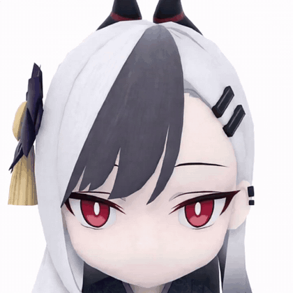

# Turn Muse into a Blue Archive Student — Persona Tutorial

  

<em>The end result of this tutorial, alive in Muse: an
animated avatar of Onikata Kayoko, generated from a face reference rendered
out of her <code>.glb</code> model (Steps 1–3 below). The full animation set
is in the <a href="assets/">assets folder</a>:
<a href="assets/kayoko-idle.mp4">idle</a> ·
<a href="assets/kayoko-making.mp4">making</a> ·
<a href="assets/kayoko-working.mp4">working</a> ·
<a href="assets/kayoko-levelup.mp4">level up</a> (MP4).</em>

A step-by-step tutorial for making **Muse** (Meta's personal AI
assistant) take on the personality of a *Blue Archive* student — her
face as the avatar, her personality as the persona, and her name as
Muse's name.

The steps below are written in the exact order that works in a real
Muse chat: **model file first, avatar second, personality third, name
last.** It works for any student whose 3D model is available.

No coding needed. Everything is done by sending Muse a file and a few
short messages.

---

## What you get

- **Avatar** — Muse's avatar becomes the student's face, generated
  from her official 3D model.
- **Personality** — Muse replies with the student's personality and
  way of speaking.
- **Name** — Muse answers to the student's name.

---

## How Muse works (30 seconds)

Two files control who Muse is:

| File | Controls |
| --- | --- |
| `SOUL.md` | Personality and tone |
| `IDENTITY.md` | The assistant's name |

You never have to edit them by hand: you ask Muse in chat, and Muse
edits them for you. (On the web you can also open them yourself at
[muse.ai](https://muse.ai) → your avatar → **Identity** tab. The
Android app has no Identity tab, so on a phone, asking in chat is the
way.)

---

## Step 1 — Download the student's .glb model file

Student 3D models (in `.glb` format) are collected in this repository:

**https://github.com/lihaohong6/BlueArchiveModels**

Find your student's file — names follow the pattern `<Student>.glb`
or `<Student> (Variant).glb` — and download it to your phone or
computer.

## Step 2 — Attach the .glb file and send the avatar prompt

Open a chat with Muse. **Attach the `.glb` file itself** to the chat
(the same way you would attach a photo), then copy the **universal
avatar prompt** from [PROMPT.md](PROMPT.md) (section 2) and send it
**in the same message as the file**.

That single message is the whole request: the prompt tells Muse to
analyze the file (meshes, textures and materials, rig / skeleton,
blendshapes / morph targets, built-in animations), match the
character's face as closely as possible, and focus the framing on the
face in a close-up.

## Step 3 — Pick one of the avatar options

Muse renders a face close-up from the model and generates several
avatar options from it (different shading / detail styles).

Reply with the option you like — tap the image, or just answer with
its number, for example:

> Option 2

Muse then sets that option as its active avatar.

One honest limitation, which the prompt tells Muse to state itself:
the animation clips inside a `.glb` file cannot be imported into
Muse's avatar system. The model is the exact visual reference for the
avatar; Muse must report what the file contains instead of pretending
the animations were transferred.

## Step 4 — Give Muse the student's personality

Now ask Muse to research the student and turn her personality into
its own persona. Send a message like this (replace the name):

> Use your browser and look up **\<student's full name\> (Blue
> Archive)** on the Blue Archive Wiki (Fandom) and on bluearchive.wiki.
> Study her personality, and turn it into your persona in your SOUL.

Muse reads the character's wiki pages, extracts how she behaves and
speaks, and writes that into its `SOUL.md`. From that point on, its
replies follow her character — while it stays a competent assistant
underneath.

Prefer to write the persona yourself? [PROMPT.md](PROMPT.md)
(section 1) has a blank template with `[PLACEHOLDERS]`: fill it in from
the student's wiki page and send the finished text to Muse instead.

## Step 5 — Rename Muse

Send one short message:

> Change your name to \<student's name\>.

Muse updates its `IDENTITY.md`, and from then on it calls itself by
that name — avatar, personality, and name now all match the student.

## Step 6 — Steer by correction

Use the result and correct whatever feels off, in short messages:

> Too cheerful — she is quieter than that.
> Keep the answers shorter.

Muse adopts each correction into its persona. A few rounds of this is
what makes the persona feel right, and it is exactly how the process
was done and refined in practice.

---

## Credits

- Tutorial by **Anatraen**, written from a real Muse session.
- Prompts: [PROMPT.md](PROMPT.md) in this repository.
- 3D models: [lihaohong6/BlueArchiveModels](https://github.com/lihaohong6/BlueArchiveModels)
- Character facts: Blue Archive Wiki contributors.

## Disclaimer

This is an unofficial, fan-made project for personal use. *Blue Archive*
and all of its characters are trademarks and copyrights of NEXON Games
Co., Ltd. and Yostar. Muse is a product of Meta. The 3D models belong to
their respective owners. No copyright infringement is intended.
